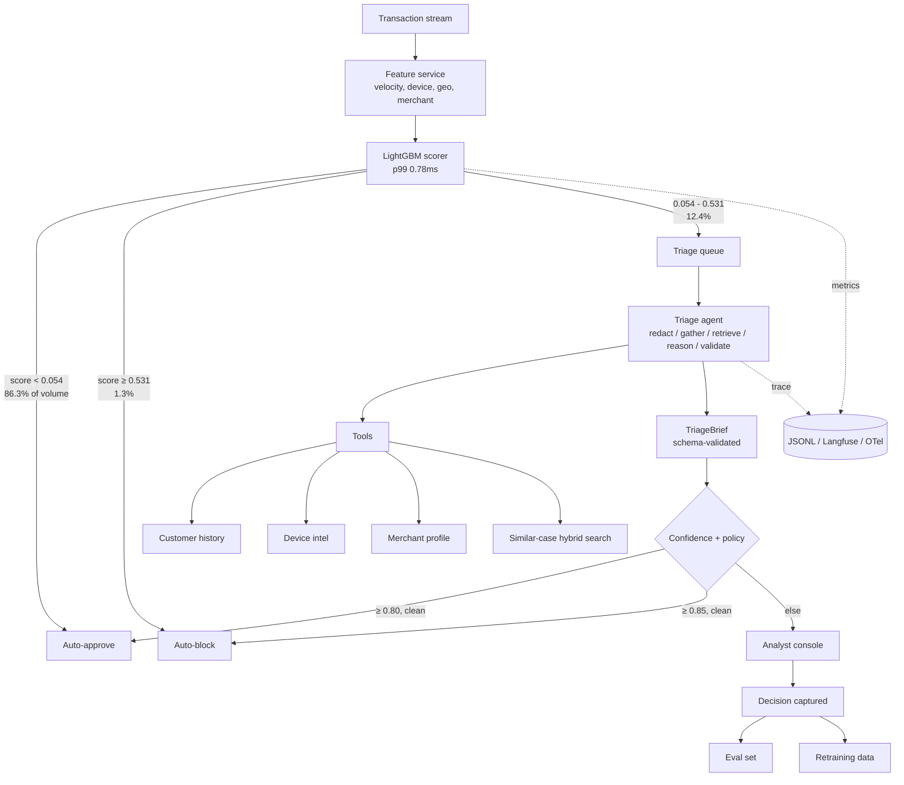

# fraudsight — system specification

## 1. The problem

Card fraud detection has a structural imbalance. Rule engines and ML scorers
flag far more transactions than analysts can review; typically 90–95% of alerts
are false positives. Analysts spend most of a review **assembling context** —
pulling customer history, device reputation, merchant profile, comparable past
cases — and only a small fraction actually deciding.

Both errors are expensive and they are not equally expensive. A missed fraud
costs the average net loss on the transaction. A wrongly declined genuine
customer costs churn and goodwill, which is smaller per event but lands on the
customers you most want to keep.

**Thesis:** keep the fast statistical model for scoring, and put an LLM in the
*investigation* layer to assemble evidence and write the analyst's brief. Cut
review effort, not recall.

## 2. Capabilities

| ID | Capability | Where |
|---|---|---|
| C1 | Ingest a transaction stream and compute features in real time | `features/online.py`, `features/store.py` |
| C2 | Score fraud risk with a gradient-boosted model | `scoring/serve.py` |
| C3 | Route by score band: auto-approve / auto-block / triage | `scoring/serve.py`, `scoring/thresholds.py` |
| C4 | LLM triage gathers evidence via tools and retrieves similar cases | `triage/graph.py`, `tools/` |
| C5 | Emit a structured analyst brief with narrative, evidence, recommendation, confidence | `triage/schema.py` |
| C6 | Analyst console with one-click decision capture | `console/app.py`, `api/app.py` |
| C7 | Feed analyst decisions into the eval set and retraining data | `api/app.py::/decision` |
| C8 | Self-report accuracy, cost, latency and drift daily | `observability/cost.py` |

## 3. Non-functional requirements, and what was measured

| Requirement | Target | Measured | Status |
|---|---|---|---|
| Scoring path p99 latency | < 50 ms | **6.14 ms** under a 40k replay | met, 8× headroom |
| Triage path p95 latency | < 6 s | **4.30 s** (see note) | met, with a caveat |
| Throughput | 2,000 tps | **487 tps / worker** | needs 4–5 workers |
| Recall on confirmed fraud | ≥ 0.95 | **0.736** | **missed** — [ADR 0005](adr/0005-expected-cost-thresholds.md) |
| Analyst review volume | ≤ 15% of transactions | **12.5%** | met |
| Cost per 1,000 alerts triaged | < $0.60 | $0.00 (no LLM configured) | not exercised |
| Graceful degradation | never drop a transaction | verified in tests | met |
| Data protection | no raw PAN/PII in prompts or traces | verified in tests | met |

**Triage latency note.** 4.30 s p95 is measured against the *deterministic*
provider, which runs in-process and is CPU-bound, so concurrent triages contend
on the GIL. A single un-contended run is ~130 ms. Against a network-bound LLM
the shape is completely different — the calls overlap and the wall clock is
dominated by the provider. So this row is met on the configuration that was
actually run, and the number should be re-measured before it is quoted for a
deployment with a real model.

**Scoring latency note.** 0.78 ms p99 in isolation; 6.14 ms p99 sustained across
a 40,000-transaction replay. The second is the number to trust — it includes
feature computation, velocity windows, and everything else on the request path.

## 4. Architecture

Narrate it in this order: **volume funnel → why the cheap model is first → what
the LLM adds → why a human still decides the middle band → how the loop closes.**

## 5. Data

| Purpose | Source | Rows |
|---|---|---|
| Training, calibration, evaluation | IEEE-CIS Fraud Detection | 590,540 raw → 547,099 after embargo |
| Streaming replay | Same, test split, event-time ordered | 84,233 |
| Entity context | Derived: 11,968 customers, 201 devices, 500 merchant proxies | training window only |
| Similar-case corpus | 1,500 resolved cases, 40% fraud | training window only |
| Triage eval set | 150 labelled cases, 3 strata | val window only |

Splits are **time-ordered with a 14-day embargo**, never random. See
[docs/scope.md](scope.md) for why 14 rather than 45.

## 6. The cost matrix

Every band boundary derives from these, and they are business inputs, not
hyperparameters:

| Input | Value |
|---|---|
| Average net loss on a missed fraud | $180.00 |
| Churn cost of a wrongly declined customer | $25.00 |
| Analyst review (6 min × $42/h loaded) | $4.20 |
| One LLM triage | $0.0012 |
| Analyst accuracy working from a brief | 0.92 |

The seven-to-one ratio between a missed fraud and a false decline is why the
optimiser trades precision for recall, and why recall is treated as a
constraint rather than a term in the objective.

## 7. Evaluation

**Track A — the scorer.** Time-based split, AUC-PR (not ROC-AUC, which the class
imbalance flatters), recall at fixed FPR, calibration curve and ECE, expected
cost at the chosen bands, 3 seeds with mean ± std.

**Track B — the agent.** 150 cases across three strata, scored on agreement,
decisive rate, schema compliance, numeric groundedness, policy cleanliness,
narrative quality, confidence calibration, cost and latency — each against the
rule-based floor, so the LLM's contribution is a delta rather than an absolute.

**The gate.** `fraudsight gate` exits non-zero below the floors. Judge-derived
metrics are gated only once the judge is calibrated against independent labels;
until then they are reported and explicitly not gated.

## 8. Out of scope

See [docs/scope.md](scope.md) — it is the longer and more useful half of this
specification.
